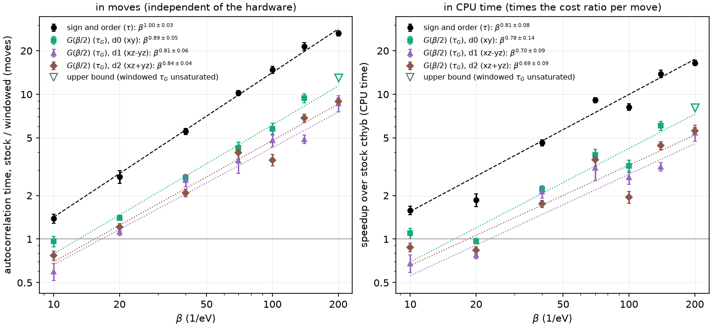

# Speedup over stock cthyb against temperature: Sr2RuO4

How much CPU time windowed mode saves over stock cthyb on a realistic
three-orbital impurity problem, from β = 10 to β = 200 (1/eV), measured on
G(β/2) itself, which is what a DMFT loop uses. The speedup on the sign and
the perturbation order is shown alongside for comparison.

**Key result:** measured on G(β/2), windowed mode needs **5.4–5.6× less CPU
time per independent sample than stock at β = 200** (at most 8× for the xy-like
orbital, where only a bound was reached). The gain grows as ≈ β^0.7–0.8. It is
below 1 up to β = 20 and above 1 from β = 40 on. Counted in moves, which does
not depend on the hardware, the gain at β = 200 is 8.7–8.9× (at most 13×),
growing as β^0.8–0.9.

On the sign and the perturbation order, which are what `auto_corr_time` sees,
the gain is two to three times larger: 16.5× in CPU time at β = 200. With both
move sets, G(β/2) decorrelates more slowly than the order, and the more so with
windowed moves. A likely reason is that short pairs renew the order and the sign
quickly, but the long-time structure of the configuration, which G(β/2)
depends on, more slowly.

## Model

- **Lattice:** the t2g bands of Sr2RuO4, a three-orbital (xy, xz, yz) Wannier90
  Hamiltonian, on a 40 × 40 × 10 k-mesh.
- **Interaction:** Kanamori, with U = 2.3 eV and J = 0.175 U = 0.4025 eV,
  including spin-flip and pair-hopping terms; t2g⁴ filling.
- **Impurity problem at each β:** the Weiss field of the first DMFT iteration
  from a self-energy computed with a ghost-embedding (GEM) solution with B = 3
  bath copies, at T = 0.005 eV. That self-energy is rebuilt analytically on
  the Matsubara mesh of each β, with the same frequency cutoff (n_iw = 2049
  at β = 200) and the same chemical potential at every β.
- **Solver set-up:** the impurity is solved in the eigenbasis of the local
  Hamiltonian. There, the xz ↔ yz mirror symmetry splits each spin into a
  2 × 2 block and a 1 × 1 block. The solver orbitals are d0 (xy-like), d1
  ((xz − yz)-like, odd under the mirror) and d2 ((xz + yz)-like).
  Autopartition finds 44 subspaces. The density matrix is measured with
  `use_norm_as_weight = True`, with `random_name = "mt19937"` and
  `det_n_operations_before_check = 100`.
- **Average perturbation order:** grows from 7.7 at β = 10 to 171 at β = 200.
  The average sign, averaged over the chains of each β and move set, is
  ≥ 0.986. One stock chain at β = 200 fell to 0.17.

## Method

Both move sets run on the same build of this fork:
- **windowed:** `windowed_moves = True`, `window_half_width = 3`, with the
  other window parameters at their defaults (w4 = w, d_min = β/4);
- **stock:** `windowed_moves = False`, which is stock cthyb 4.0.1 bit for bit.

The cost of a move is therefore compared like with like. The window is the
same at every β, so it covers 60% of the imaginary-time circle (2w/β) at
β = 10 and 3% at β = 200. It was not tuned per temperature.

For each β and move set:

1. **Pilot:** 2 chains × 1000 cycles at 4 lengths, to locate the
   autocorrelation time.
2. **Main runs:** 8 independent chains × 4000 cycles at each of 8 values of
   `length_cycle`, spaced by √2 around the pilot's estimate. Each run starts
   after a warmup of max(5·10⁴ β, 20 τ) moves. Each chain is one serial process.
3. **Autocorrelation time of G(β/2):** `measure_G_auto_corr_time = True`, on
   this fork's branch `g-auto-corr-time` (see its README).
   - Once per cycle, the measure takes the `G_tau` estimator restricted to the
     pairs whose time difference lies within β/2 ± 0.05 β
     (`G_auto_corr_window = 0.1`), for each block and diagonal element.
   - The values go into a log-binning accumulator, and τ_G is read off by the
     same rule as `auto_corr_time`. It is averaged over the two spins of each
     solver orbital.
   - The measure only reads the configuration, so the chains are bit for bit
     the same as without it.
   - τ_G is fitted as a_G / `length_cycle`, over the lengths at which at least
     half the chains' estimates saturated and 0.3 ≤ τ_G ≤ 3 cycles. a_G is
     then the autocorrelation time of G(β/2) in moves.
4. **Autocorrelation time of the sign and the order:** `S.auto_corr_time`,
   fitted in the same way as a / `length_cycle`, with 0.8 ≤ τ ≤ 2.2 cycles.
5. **Cost per move:** c = CPU time / moves, with everything included: warmup,
   measurements, and the windows' overhead.
6. **Speedup:**
   - Right panel: (a_G c)_stock / (a_G c)_windowed, the ratio of the CPU times
     per independent sample of G(β/2).
   - Left panel: a_G,stock / a_G,windowed, the same ratio counted in moves.
   - Black points in both: the same ratios with a, for the sign and the order.

τ_G·`length_cycle` grows with the length until the estimates saturate, then
stays flat. At β = 200, the windowed τ_G of d0 is 3.8–10 cycles and did not
saturate at any length. Its largest τ_G·`length_cycle` (23 000 moves) is then
a lower bound on a_G, so the speedup there is an upper bound (open triangle).

In total there were 1008 solves on the CPU nodes of Bunya (University of
Queensland), 83 core-hours, with one core per chain.

## Results

Speedup on G(β/2), per solver orbital, and on the sign and the order:

| β | order | c_windowed / c_stock | G(β/2), CPU time: d0 / d1 / d2 | sign and order, CPU time | G(β/2), moves: d0 / d1 / d2 | sign and order, moves |
|---|---|---|---|---|---|---|
| 10 | 7.7 | 0.88 | 1.10 / 0.68 / 0.88 | 1.58 ± 0.11 | 0.97 / 0.60 / 0.77 | 1.39 |
| 20 | 16.2 | 1.45 | 0.97 / 0.78 / 0.84 | 1.87 ± 0.19 | 1.40 / 1.13 / 1.21 | 2.70 |
| 40 | 33.4 | 1.20 | 2.22 / 2.13 / 1.75 | 4.63 ± 0.23 | 2.66 / 2.55 / 2.09 | 5.54 |
| 70 | 59.3 | 1.12 | 3.82 / 3.10 / 3.53 | 9.10 ± 0.36 | 4.29 / 3.48 / 3.96 | 10.2 |
| 100 | 84.8 | 1.81 | 3.20 / 2.67 / 1.95 | 8.17 ± 0.46 | 5.78 / 4.82 / 3.52 | 14.8 |
| 140 | 119.4 | 1.55 | 6.08 / 3.16 / 4.43 | 13.9 ± 0.8 | 9.41 / 4.89 / 6.85 | 21.5 |
| 200 | 170.8 | 1.60 | ≤ 8.1 / 5.43 / 5.59 | 16.5 ± 0.7 | ≤ 13.0 / 8.68 / 8.94 | 26.4 |

The fits of a_G make the speedups on G(β/2) uncertain by 4–13% (18% for d1 at
β = 70).

Autocorrelation times in moves: a_G for d0 / d1 / d2, and a for the sign and
the order:

| β | a_G, stock | a_G, windowed | a, stock | a, windowed |
|---|---|---|---|---|
| 10 | 62 / 18 / 58 | 64 / 29 / 75 | 217 ± 11 | 157 ± 7 |
| 20 | 389 / 90 / 296 | 278 / 80 / 245 | 1276 ± 40 | 473 ± 45 |
| 40 | 3350 / 534 / 1610 | 1260 / 209 / 768 | 6040 ± 180 | 1091 ± 42 |
| 70 | 18 600 / 2060 / 7390 | 4350 / 592 / 1870 | 20 850 ± 630 | 2042 ± 52 |
| 100 | 47 200 / 5880 / 12 200 | 8170 / 1220 / 3460 | 43 300 ± 1800 | 2935 ± 113 |
| 140 | 139 500 / 11 200 / 40 000 | 14 800 / 2290 / 5840 | 84 400 ± 2000 | 3936 ± 208 |
| 200 | 299 000 / 36 800 / 104 000 | ≥ 23 000 / 4240 / 11 700 | 160 000 ± 5000 | 6055 ± 166 |

Power laws over β = 10 to 200:

| quantity | windowed | stock |
|---|---|---|
| a_G, d0 / d1 / d2 (moves) | β^2.09±0.03 (to β = 140) / β^1.65±0.04 / β^1.66±0.02 | β^2.91±0.06 / β^2.53±0.04 / β^2.49±0.05 |
| a, sign and order (moves) | β^1.18±0.05 | β^2.16±0.05 |
| cost per move | β^0.12±0.07 | β^−0.05±0.09 |
| speedup on G(β/2) in moves, d0 / d1 / d2 | β^0.89±0.05 / β^0.81±0.06 / β^0.84±0.04 | |
| speedup on G(β/2) in CPU time, d0 / d1 / d2 | β^0.78±0.14 / β^0.70±0.09 / β^0.69±0.09 | |
| speedup on the sign and the order in CPU time | β^0.81±0.08 | |

G(β/2) decorrelates more slowly than the order, increasingly so at low
temperature:
- **d0:** a_G/a grows from 0.4 at β = 10 to 3.8 at β = 140–200 with windowed
  moves, against 0.3 to 1.9 with stock moves.
- **d1:** decorrelates fastest, at a_G/a ≈ 0.07–0.7.

With windowed moves, a_G grows about 0.8–0.9 powers of β more slowly than
with stock moves (β^1.7–2.1 against β^2.5–2.9). That is where the gain comes
from.

A windowed move costs 0.9–1.8× a stock one. The extra cost comes from more
proposals passing the quick-abandon test and getting full updates.

G(β/2) agrees between windowed and stock to within 2 standard errors in every
solver orbital at every β.

## Caveats

- **The cost ratio is the noisiest factor.** The jobs ran on shared nodes. Two
  earlier runs of the same chains gave c_windowed / c_stock = 1.1–1.7 and
  1.0–1.4, against 0.9–1.8 here. It was 1.81 at β = 100, where both move sets
  ran on the same node. This scales all the CPU-time speedups at a given β
  together. The speedups in moves (left panel) are free of it.
- **d0 at β = 200** is an upper bound only (see *Method*). Longer runs, or
  lengths chosen for τ_G rather than for the sign/order τ, would pin it down.
- **One observable:** τ_G is that of G(τ) in the window β/2 ± 0.05 β. Other
  parts of G(τ), and other observables such as the density matrix, may
  decorrelate on different time scales.
- **One model, one window:** w = 3 is fixed. At high temperature the window
  covers most of [0, β), which makes the moves nearly stock ones, so the small
  speedup there is partly by construction. A w chosen per β from the accepted
  pair lengths (see *Choosing w* in the top-level README) may do better.
