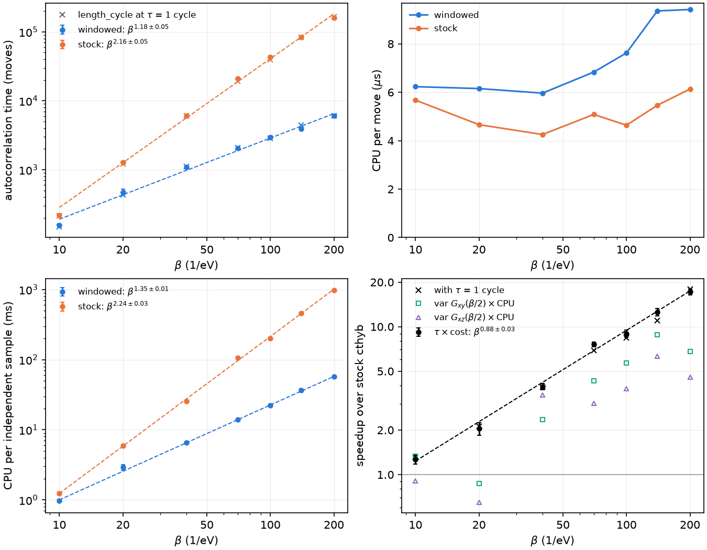

# Speedup over stock cthyb against temperature: Sr2RuO4

How much CPU time windowed mode saves over stock cthyb on a realistic
three-orbital impurity problem, from β = 10 to β = 200 (1/eV).

**Key result:** the CPU time per independent sample is **1.3× lower than stock at
β = 10 and 17× lower at β = 200**, the gain growing as ≈ β^0.9. Nearly all of
it comes from the autocorrelation time. In moves it grows as β^1.18 with
windowed moves and as β^2.16 with stock ones. A windowed move costs 1.1–1.7×
a stock one. Measured on G(β/2) directly, the gain is smaller, about 5–12×
at β = 200 (see *Caveats*).

## Model

- **Lattice:** the t2g bands of Sr2RuO4, a three-orbital (xy, xz, yz) Wannier90
  Hamiltonian, on a 40 × 40 × 10 k-mesh.
- **Interaction:** Kanamori, with U = 2.3 eV and J = 0.175 U = 0.4025 eV,
  including spin-flip and pair-hopping terms; t2g⁴ filling.
- **Impurity problem at each β:** the Weiss field of the first DMFT iteration
  from a self-energy computed with a ghost-embedding (GEM) solution with B = 3
  bath copies, at T = 0.005 eV. That self-energy is rebuilt analytically on
  the Matsubara mesh of each β, with the same frequency cutoff (n_iw = 2049
  at β = 200) and the same chemical potential at every β.
- **Solver set-up:** the impurity is solved in the eigenbasis of the local
  Hamiltonian, in which the xz ↔ yz mirror symmetry splits each spin into a
  2 × 2 block and a 1 × 1 block. Autopartition then finds 44 subspaces.
  The density matrix is measured with `use_norm_as_weight = True`, with
  `random_name = "mt19937"` and `det_n_operations_before_check = 100`.
- **Average perturbation order:** grows from 7.7 at β = 10 to 171 at β = 200.
  The average sign, averaged over the chains of each β and move set, is
  ≥ 0.986; only a few single chains fall lower (see *Caveats*).

## Method

Both move sets run on the same build of this fork:
- **windowed:** `windowed_moves = True`, `window_half_width = 3`, with the
  other window parameters at their defaults (w4 = w, d_min = β/4);
- **stock:** `windowed_moves = False`, which is stock cthyb 4.0.1 bit for bit.

The cost of a move is therefore compared like with like. The window is the
same at every β, so it covers 60% of the imaginary-time circle (2w/β) at
β = 10 and 3% at β = 200. It was not tuned per temperature.

For each β and move set:

1. **Pilot:** 2 chains × 1000 cycles at 4 lengths, to locate the
   autocorrelation time.
2. **Main runs:** 8 independent chains × 4000 cycles at each of 8 values of
   `length_cycle` spaced by √2 around the pilot's estimate, after a warmup of
   max(5·10⁴ β, 20 τ) moves. Each chain is one serial process.
3. **Autocorrelation time:** `S.auto_corr_time`, cthyb's estimate in cycles
   (from the sign and the perturbation order), fitted as τ = a / length_cycle.
   The fit uses the lengths at which at least half the chains' estimates
   saturated and 0.8 ≤ τ ≤ 2.2 cycles, weighted by the standard error over
   the chains. a is then the autocorrelation time in moves.
4. **Cost per move:** c = CPU time / moves, with everything included: warmup,
   measurements, and the windows' overhead.
5. **Speedup:** S = (a c)_stock / (a c)_windowed, the ratio of the CPU times
   per independent sample.

Two cross-checks:
- **S at τ = 1 cycle:** the same ratio with a replaced by the `length_cycle`
  at which τ = 1 cycle (the choice in cthyb's guide). It agrees with S to
  within ≈ 10% at every β (× in the plot).
- **From var G(β/2):** the variance of G(β/2) across the 8 chains, times the
  CPU time of a solve, is proportional to the CPU time per independent sample
  *of G(β/2)* itself. It does not rely on `auto_corr_time` at all. Its ratio
  is plotted as open symbols (xy, xz); each value is uncertain by ≈ 27%.

In total there were 1008 solves on the CPU nodes of Bunya (University of
Queensland), 86 core-hours, with one core per chain.

## Results

| β | order | τ, stock (moves) | τ, windowed (moves) | c_windowed / c_stock | CPU per sample, stock (ms) | CPU per sample, windowed (ms) | speedup S | S at τ = 1 cycle | from var G(β/2), xy / xz |
|---|---|---|---|---|---|---|---|---|---|
| 10 | 7.7 | 217 ± 11 | 157 ± 7 | 1.10 | 1.23 | 0.98 | 1.27 ± 0.09 | 1.31 | 1.33 / 0.91 |
| 20 | 16.2 | 1276 ± 40 | 473 ± 45 | 1.32 | 5.95 | 2.91 | 2.04 ± 0.21 | 2.12 | 0.87 / 0.65 |
| 40 | 33.4 | 6040 ± 180 | 1091 ± 42 | 1.40 | 25.7 | 6.51 | 3.95 ± 0.19 | 3.90 | 2.35 / 3.46 |
| 70 | 59.3 | 20850 ± 630 | 2042 ± 52 | 1.34 | 106 | 14.0 | 7.60 ± 0.30 | 6.93 | 4.32 / 3.04 |
| 100 | 84.8 | 43300 ± 1800 | 2935 ± 113 | 1.64 | 201 | 22.4 | 8.98 ± 0.50 | 8.38 | 5.69 / 3.82 |
| 140 | 119.4 | 84400 ± 2000 | 3936 ± 208 | 1.71 | 461 | 36.8 | 12.5 ± 0.7 | 11.0 | 8.79 / 6.33 |
| 200 | 170.8 | 160000 ± 5000 | 6055 ± 166 | 1.54 | 980 | 57.0 | 17.2 ± 0.7 | 17.9 | 6.81 / 4.56 |

Power laws over β = 10 to 200:

| quantity | windowed | stock |
|---|---|---|
| autocorrelation time in moves | β^1.18±0.05 | β^2.16±0.05 |
| cost per move | β^0.15±0.04 | β^0.03±0.05 |
| CPU per independent sample | β^1.35±0.01 | β^2.24±0.03 |
| speedup S | β^0.88±0.03 | |

The autocorrelation time in moves of the windowed moves grows about one power
of β more slowly than stock's, for the same perturbation order (∝ β^1.03 for
both). That is the expected gain from proposing pairs at the lengths that are
accepted rather than uniformly on [0, β). The windows' extra cost per move,
from more proposals passing the quick-abandon test and getting full updates,
takes away only about β^0.12 of it.

G(β/2) agrees between windowed and stock to within 2 standard errors at every β.

## Caveats

- **`auto_corr_time` sees only the sign and the perturbation order.** The
  speedup measured on G(β/2) directly, the open symbols (after excluding the
  stray chains below), matches S at β = 10. From β = 20 on it is about
  0.3–0.9 of S. At β = 200 it is ≈ 5–7, or ≈ 12 for xy if the stray chains
  are kept, depending on the orbital. Short-pair moves decorrelate the order
  and the sign faster than they do the long-time structure that G(β/2)
  depends on. For G(τ), the practical gain is therefore probably smaller than
  S, though still large at low temperature.
- **Stray chains:** 16 of the 448 stock solves and 1 of the 448 windowed ones
  have a G(β/2) more than 5 standard deviations from the other chains at the
  same length. Their average sign stays near 1, except one stock chain at
  β = 200 whose average sign fell to 0.17. These excursions are not specific
  to windowed mode.
- **One model, one window:** w = 3 is fixed. At high temperature it covers
  most of [0, β), which makes the moves nearly stock ones, so the small
  speedup there is partly by construction. A w chosen per β from the accepted
  pair lengths (see *Choosing w* in the top-level README) may do better.
